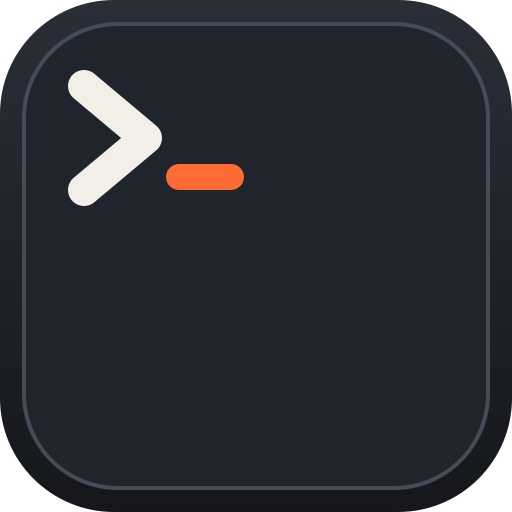

<div align="center">



### tty59

**A terminal workbench: persistent sessions, remote work, agents.**

<sub>Rust · GPU rendering on Zed's gpui · VT core from Ghostty (libghostty-vt)</sub>

<sub>A fork of <a href="https://github.com/l0ng-ai/tty7">tty7</a> by <a href="https://github.com/l0ng-ai">l0ng-ai</a>. The only difference is the terminal engine, libghostty-vt. See <a href="#credits">Credits</a>.</sub>

<br />

[](https://github.com/nathabonfim59/tty59/actions/workflows/ci.yml)
[](https://github.com/nathabonfim59/tty59/releases)
[](https://github.com/nathabonfim59/tty59/releases)
[](LICENSE)
[](https://discord.gg/s3dethqz2V)

<sub>English · [简体中文](README.zh-CN.md)</sub>

<br />

<a href="assets/tour.mp4"></a>

<sub>▶ <a href="assets/tour.mp4">Watch in full quality</a></sub>

</div>

## Why

A background server owns your shells and panes — not the window. Everything
below follows from that.

- **Performance**: libghostty-vt parses plain text about 2× faster, and full-screen output several times faster, than the previous engine in engine-level benches; end to end, the results are mixed ([benchmarks](#benchmarks))
- **Persistent sessions** — quit the app and your shells keep running; after a reboot, layout, screen, and supported agent conversations come back. No tmux
- **Agent-aware** — Claude Code, Codex & co.: status, notifications, and git context for every repo at once
- **Scriptable by agents** — one agent opens a pane for another, hands off a task, waits, and reads the result, with or without the GUI running
- **Editor-grade input** — suggestions, completion, highlighting, history search, with no plugin to install
- **Remote development** — files, repos, panes, and git data stay on the remote machine, over a native SSH stack

## Install

Native builds for macOS, Windows, and Linux on [**Releases**](https://github.com/nathabonfim59/tty59/releases):

| | | |
|---|---|---|
| **macOS** | `…-macos-arm64.dmg` · `…-x86_64.dmg` | drag into Applications |
| **Windows** | `…-setup.exe` · portable `….zip` | |
| **Linux** | `…-x86_64.AppImage` | `chmod +x` and run — X11/Wayland libraries bundled; needs glibc ≥ 2.39 |

## What's inside

| | |
|---|---|
| **Agent-aware** | per-pane detection (28 CLIs) · status dot · notifications · branch + diff · tray icon when input is needed · resume after reboot · reopen any past session from Search Everywhere · one-key launch · tab sidebar grouped by repository, with pinned groups |
| **CLI + Skills** | bundled `tty59` CLI · [agent skill](skills/tty59/SKILL.md) · `run` streams a command and exits with its code · `split` · `send` · `wait --until free` · `capture` |
| **Editor-grade input** | ghost suggestions from history · explained tab completion · syntax highlighting · multi-line editing · click places the caret · <kbd>⌃ R</kbd> fuzzy history |
| **Window** | tabs & splits · <kbd>⌘ P</kbd> Search Everywhere · <kbd>⌘ F</kbd> scrollback search · hibernate a tab to free its memory · IME |
| **Side panel** | <kbd>⌘ J</kbd> · process tree and listening ports · file tree · changes and diffs · find in files · GitHub issues and pull requests, read-only, signed in through `gh` |
| **Shell integration** | injected when a pane starts, nothing to install · prompt marks · working directory · exit codes · command-finished notifications · zsh, bash, fish, PowerShell, WSL, remote panes |
| **Remote workspaces** | remote files, repos, changes, diffs, worktrees, tabs, and panes · reconnect from any client and continue where you left off |
| **SSH** | native russh stack: profiles with keychain secrets · SFTP panel · port forwarding · jump hosts · one-time, unprivileged `tty59-server` install |

## Supported agents

**Detection** is free: brand avatar, branch + diff, tab title.
**Status** takes one click under Settings → Integrations to install that agent's hook,
and brings the status dot, notifications, the tray icon, `tty59 wait`, and resume
after a reboot. **Fork** needs both — the agent's own fork command, and the hook
that tells tty59 which session to fork. **Past sessions** are read from the agent's
own history files and listed in Search Everywhere, where <kbd>⏎</kbd> resumes one.

<details>
<summary>The full support matrix, all twenty-eight</summary>

| Agent | Detected | Status · resume | Fork | Past sessions |
|---|:-:|:-:|:-:|:-:|
| **Claude Code** | ✓ | ✓ | ✓ | ✓ |
| **Codex** | ✓ | ✓ | ✓ | ✓ |
| **TraeCode** | ✓ | ✓ | ✓ |  |
| **Grok** | ✓ | ✓ | ✓ |  |
| **OpenCode** | ✓ | ✓ | ✓ | ✓ |
| **Oh My Pi** | ✓ | ✓ | ✓ | ✓ |
| **Prime Agent** | ✓ | ✓ | ✓ |  |
| **Droid** | ✓ | ✓ | ✓ | ✓ |
| **Qwen Code** | ✓ | ✓ | ✓ | ✓ |
| **Goose** | ✓ | ✓ | ✓ |  |
| **Qoder CLI** | ✓ | ✓ | ✓ | ✓ |
| **Qoder CN CLI** | ✓ | ✓ | ✓ | ✓ |
| **CodeBuddy** | ✓ | ✓ | ✓ | ✓ |
| **Gemini** | ✓ | ✓ | | ✓ |
| **Copilot** | ✓ | ✓ | | ✓ |
| **Kimi Code** | ✓ | ✓ | | ✓ |
| **Pi** | ✓ | ✓ | | ✓ |
| **Crush** | ✓ | ✓ | |  |
| **Antigravity** | ✓ | ✓ | |  |
| **Cursor** | ✓ | ✓ | | ✓ |
| **Empryo** | ✓ | ✓ | |  |
| **Muse Code** | ✓ | ✓ | |  |
| **jcode** | ✓ | ✓ | |  |
| Aider | ✓ | | |  |
| Amp | ✓ | | |  |
| Auggie | ✓ | | |  |
| Hermes | ✓ | | |  |
| Vibe | ✓ | | |  |

</details>

None of them are wrapped or proxied — the agent you start is the agent you get,
in a normal PTY, with its own interface. An agent launched through a wrapper
script can be mapped to one by name with `agent_commands` in `config.json`.
Every agent on your `PATH` is also a row in Search Everywhere (**Agent: Claude Code**, …)
that opens it in a new tab, and the New Tab menu names the ones you have actually
run. `agent_launch` sets the command line it starts with.

## Documentation

Full documentation lives in [**`docs/`**](docs/) —
[keyboard shortcuts](docs/reference/keyboard-shortcuts.mdx) ·
[config.json](docs/reference/configuration.mdx) ·
[CLI reference](docs/cli/reference.mdx). The agent-facing CLI interface is also
documented in [skills/tty59/SKILL.md](skills/tty59/SKILL.md).

Install the skill with:

```sh
npx skills add nathabonfim59/tty59    # install
npx skills update tty59         # update later
```

## Benchmarks

Since the engine switch to libghostty-vt, the honest numbers are from the
machine that measured the switch — a Linux desktop (Arch, Wayland), same
session, five-run averages at the default 80×24 grid (2026-10-29), the two
engines side by side through the whole GUI+pty stack:

| | tty59 (libghostty-vt) | tty59 (previous engine) |
|---|---:|---:|
| Plaintext I/O — 11 MB `cat` <sub>(lower = better)</sub> | **119 ms** | 127 ms |
| [DOOM-fire](https://github.com/const-void/DOOM-fire-zig) frame rate <sub>(higher = better)</sub> | 2372 fps | **2841 fps** |

<sub>At this small grid the fire test's per-frame escape churn favors the
cheaper-per-frame engine; the engine-level benches say the trade flips
with grid size (full-screen parse ~8× faster on libghostty-vt at
200×50). The against-Alacritty/Ghostty/Kitty table returns with the first
release of this engine, measured on the benchmark baseline machine at its
155×40 grid.</sub>

Methodology and one-command reproduction: [`scripts/bench/`](scripts/bench/README.md).

## Credits

tty59 is a fork of [tty7](https://github.com/l0ng-ai/tty7) by
[l0ng-ai](https://github.com/l0ng-ai) — the workbench (persistent
sessions, remote work, agents, the whole UI) is theirs. The difference in
this fork is the terminal engine: moved onto
[libghostty-vt](https://github.com/ghostty-org/ghostty), Ghostty's
renderer-free VT core (MIT, by Mitchell Hashimoto and contributors).
Credit for the engine tty7 shipped — and for code this fork still carries,
like the fair mutex the engine is shared through — goes to
[Alacritty](https://github.com/alacritty/alacritty) and its contributors.

---

<div align="center">
<sub>

Built on [gpui](https://github.com/zed-industries/zed) and [libghostty-vt](https://github.com/ghostty-org/ghostty) · [Apache-2.0](LICENSE) · [Discord](https://discord.gg/s3dethqz2V) · [Changelog](CHANGELOG.md)

</sub>
</div>
