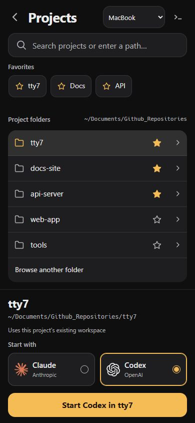

# Projects launcher verification

The screenshot is the implemented interface at 390 x 844 CSS pixels with
simulated computer responses and anonymized project names. It is browser UI
evidence, not a physical-device screenshot.

## Checks

- `cd mobile && npm run build`: TypeScript and Vite passed.
- `cargo test -p tty7-gateway -p tty7-mobile-proto -p tty7-mobile-client`:
  68 tests passed, with one existing ignored mDNS test.
- Targeted path tests passed after adding Windows drive-root, UNC-root and
  verbatim-path cases.
- Browser interaction checks: search filters folders; favorites survive a
  reload and are scoped to the computer; an explicit directory is selected;
  a double tap produces one launch request; invalid paths clear selection
  and disable Start; the Start button remains visible at 320 x 740.

## Real server and shell

A separate tty7 server and gateway were run with a private config directory.
The phone probe paired over a real iroh connection and used the same Folders
and OpenProject methods that the app calls. Paths below replace the private
test directory prefix with `<sandbox>`.

| Attempt | Directory | Workspace | Tab and pane |
| --- | --- | --- | --- |
| First launch | `<sandbox>/sample projects/alpha` | Created A | Created |
| Same launch UUID again | Same directory | Reused A | Same tab and pane |
| Fresh launch UUID | Same directory | Reused A | New tab and pane |
| Same folder name elsewhere | `<sandbox>/other/alpha` | Created B | New tab and pane |
| Nonexistent directory | `<sandbox>/no-such-project` | None added | None added |

Sending `printf "TTY7_CWD=%s\n" "$PWD"` through the pane returned the exact
selected `sample projects/alpha` directory. Claude Code 2.1.296 and Codex CLI
0.160.1 version commands ran from that shell. This verifies directory
placement and CLI availability; it does not claim a completed agent turn.

## Remaining device proof

The Android x86_64 Rust library compiled. APK packaging on macOS failed in
`processUniversalDebugResources` with an AAPT2 link timeout while the host
was heavily loaded. A PC packaging attempt did not complete either.

The new build has not been installed or exercised on a physical Android
phone. Samsung keyboard behavior, native rotation, background connection
handling, and a signed arm64 upgrade still need device verification. The
mobile release requires a matching desktop gateway release.
